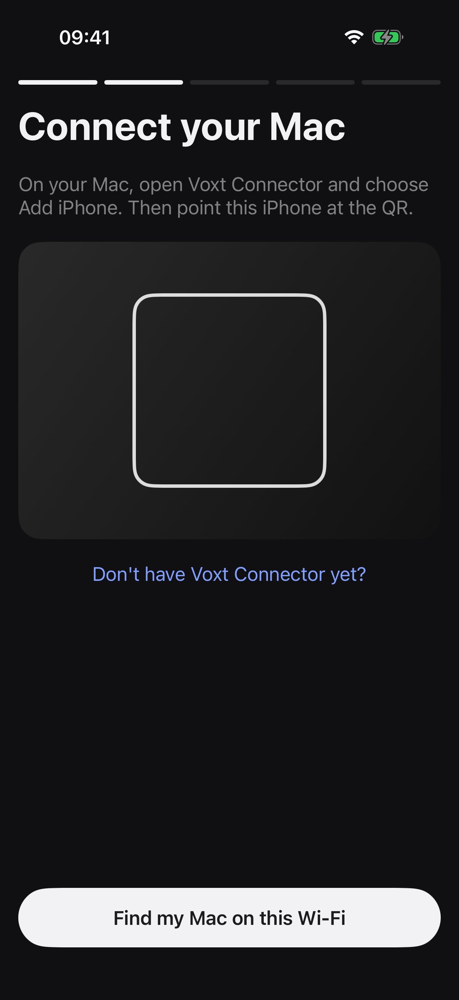

# Install Voxt Mobile

This guide needs no coding. You copy a few commands into Terminal and click through Xcode. Prefer to hand it to an AI coding agent? Point it at [AGENT-INSTALL.md](AGENT-INSTALL.md).

## What you need

- A Mac with Apple silicon (M1 or later), with space for Xcode and the models (several GB).
- An iPhone on iOS 17 or later, and a cable to connect it to the Mac.
- An Apple ID. A free one works. With a free Apple ID, the iPhone app stops opening after 7 days; to renew it, connect the phone and press Run in Xcode again (step 4).

## 1. Install the tools

1. Install **Xcode** from the Mac App Store and open it once. When it asks which platforms to install, include **iOS**.
2. In Xcode, open **Xcode → Settings → Accounts**, click **+**, choose **Apple ID** and sign in.
3. Install [Homebrew](https://brew.sh): open **Terminal** (in Applications → Utilities), paste the command shown on brew.sh, press Return, and follow what it prints.
4. In Terminal, install the build tools and download Voxt Mobile:

   ```sh
   brew install git go uv cmake ninja xcodegen
   git clone https://github.com/jt-wang/voxt-mobile.git
   cd voxt-mobile
   ```

Keep this Terminal window. The next commands run in the `voxt-mobile` folder.

## 2. Build and start Voxt on the Mac

Voxt Mobile uses a development build of Voxt called **Voxt Omni Dev**. It runs next to a normal Voxt install without touching it.

```sh
tools/omni-dev.sh prepare
tools/omni-dev.sh build
tools/omni-dev.sh run
```

`prepare` downloads Voxt's source (release 1.16.0, upstream tag `voxt-v1.16.0`), `build` builds it (the first time takes a while), and `run` opens **Voxt Omni Dev**. Leave this Terminal window open while you use Voxt Mobile; closing it quits Voxt Omni Dev. Next time, open Terminal and run `cd voxt-mobile` and `tools/omni-dev.sh run` again.

In Voxt Omni Dev:

1. Open **Settings → Model**. Choose and download a speech model (for example Qwen3-ASR 0.6B) and a text model (for example Qwen3.5-4B). Every phone mode uses both.
2. Open **Settings → General** and turn on **Remote Input**. This page also shows a **port** and an **Access token**; step 5 tells you when you need them.
3. Recommended: in **Settings → Model**, click the gear button, and under **Memory** set **Unload Delay** to 10 minutes. Voxt then keeps the models loaded between dictations, so the next one from your phone doesn't wait for a model to load.

## 3. Prepare the iPhone

1. Connect the iPhone to the Mac with the cable and tap **Trust** on the phone.
2. On the iPhone, open **Settings → Privacy & Security → Developer Mode**, turn it on and restart the phone when asked. If you don't see **Developer Mode**, do step 4 first, then come back.

## 4. Install the iPhone app

In Terminal, in the `voxt-mobile` folder:

```sh
tools/build-tailcat-native.sh
ios/tools/set-team.sh
```

`build-tailcat-native.sh` builds the encrypted connection library. `set-team.sh` finds your Apple ID's team and gives the app IDs of its own, because a free Apple ID can't reuse anyone else's. It prints your team and ends with `Now open ios/VoxtMobile.xcodeproj, choose your iPhone and press Run.`

If it says **No "Apple Development" certificate on this Mac**, Xcode hasn't made your certificate yet. Run `open ios/VoxtMobile.xcodeproj`, click **VoxtMobile** at the top of the file list, open **Signing & Capabilities**, choose your name **(Personal Team)** under **Team**, and press **Run** (▶) once. It's fine if that fails. Then run `ios/tools/set-team.sh` again.

Then open the project:

```sh
open ios/VoxtMobile.xcodeproj
```

In Xcode, choose the **VoxtMobile** scheme and your iPhone at the top of the window, then press **Run** (▶). The first time, the phone may say the developer isn't trusted: open **Settings → General → VPN & Device Management**, tap your Apple ID and tap **Trust**, then press Run again. Voxt opens on its first screen; leave it there until step 6.

## 5. Install Voxt Connector on the Mac

Voxt Connector is a small menu-bar app that lets your iPhone reach Voxt. In Terminal:

```sh
tools/build-connector.sh
```

It signs the app with the certificate Xcode made for your Apple ID in step 4. When it finishes, it prints `build: <path>/Voxt Connector.app`. Open it:

```sh
open build/connector-derived/Build/Products/Release/"Voxt Connector.app"
```

In the **Voxt Connector** window:

1. Click **Connect**. When Voxt Omni Dev and the Connector are signed by the same developer team, as in a released build, the Connector gets the port and token from Voxt itself. A Voxt Omni Dev you built with `tools/omni-dev.sh build` isn't signed by a team, so the Connector then asks for them: enter the **Port** and **Access token** from Voxt Omni Dev → **Settings → General → Remote Input** and click **Connect** again.
2. The window shows **Connected to Voxt** and the version.
3. Optional: turn on **Open at login**. **Show in Dock** puts its icon in the Dock; with it off, open the Connector from the waveform icon in the menu bar.

## 6. Set up the iPhone app

Open **Voxt** on the iPhone. It walks you through three short steps.

<p align="center"></p>

1. **Say anything. Only your Mac hears it.** Tap **Get started**.
2. **Connect your Mac.** In Voxt Connector on the Mac, click **Add iPhone**; a QR code appears for two minutes. Point the iPhone at it (allow the camera when asked). Or, on the same Wi-Fi, tap **Find my Mac on this Wi-Fi**: the phone shows a 6-digit code, the Mac asks **Allow "iPhone" to connect?**, and you click **Allow** if the codes match. Allow **Local Network** access on both if asked. The app moves on by itself, and Voxt Connector shows **Ready for dictation**. You pair once; the phone reconnects by itself after that, also away from home.
3. **Add the Voxt keyboard.** Tap **Continue**, then on **Then allow Full Access** tap **Open Settings**. In Settings › Voxt, tap **Keyboards**, turn on **Voxt**, then turn on **Allow Full Access** and tap **Allow**. Go back to Voxt with the **◀ Voxt** link at the top left.

## 7. Try it

The app shows a **Say anything** field. If the normal keyboard is up, hold the globe key and choose **Voxt**. Tap the mic, say a sentence, and tap it again; the text appears in the field. The first time, allow the microphone. Tap **Done**.

From now on the Voxt keyboard works in any app. Two things worth setting on the iPhone:

- On **Home**, turn on **Keep Voxt ready**, so dictating in other apps doesn't switch to the Voxt app.
- In **Settings › Translation › Languages**, pick up to three languages. On the keyboard, hold the mic and slide up to one to translate.

## If something doesn't work

- **A build stops with an error:** copy the last 40 lines from Terminal and [open an issue](https://github.com/jt-wang/voxt-mobile/issues).
- **Xcode says signing failed:** check that you're signed in under Xcode → Settings → Accounts, then run `ios/tools/set-team.sh` again. If it lists more than one team, run it again with the one you want: `ios/tools/set-team.sh <TEAM_ID>`.
- **The Connector asks for a port and token, or says the token was rejected:** this Voxt Omni Dev isn't signed by the same team as the Connector; copy the port and Access token from Voxt Omni Dev's Remote Input settings.
- **The phone can't reach the Mac:** Voxt Omni Dev (its Terminal window) and Voxt Connector must both be running, and both devices need internet access. If the QR code expired, click **Add iPhone** again.
- **The keyboard says Allow Full Access is off:** open Settings › Voxt › Keyboards and turn on **Allow Full Access**.
- **The app stopped opening after a week:** connect the phone and press Run in Xcode again.
