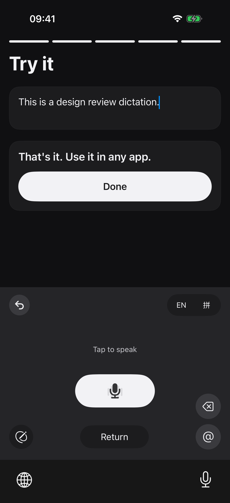
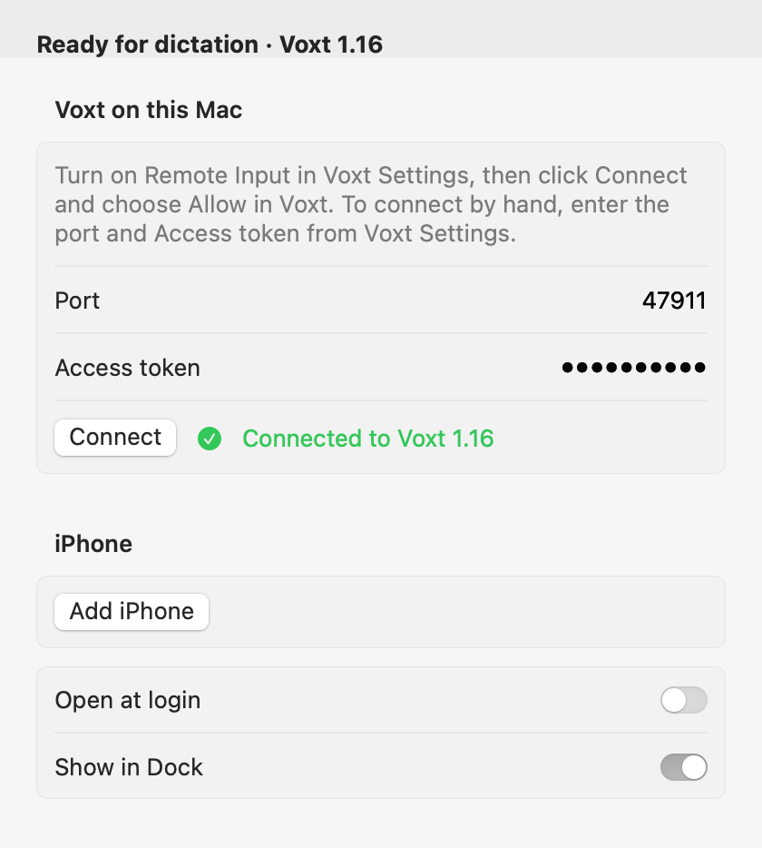
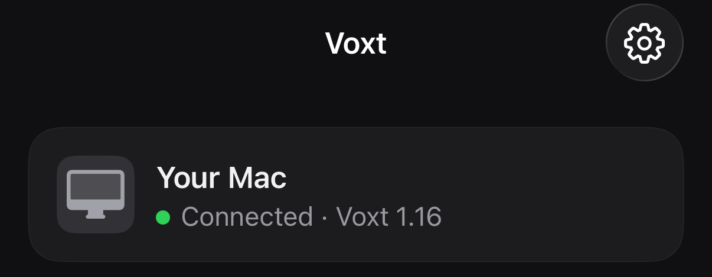

# Voxt Mobile

**Say anything. Only your Mac hears it.**

A voice keyboard for your phone. Your own Mac turns your words into clean text.

Tap the mic in any app, speak, and the text appears in the field you were typing in. The speech and text models are open source and run on your Mac.

<p align="center">
  
  &nbsp;&nbsp;
  
</p>
<p align="center">
  
</p>

It is built on [Voxt](https://github.com/sgl-project/sglang-omni/tree/main/Voxt), the open-source Mac dictation app by [hehehai](https://github.com/hehehai/voxt), now developed in [SGLang Omni](https://github.com/sgl-project/sglang-omni). Voxt runs the models; Voxt Mobile lets your phone use them.

## Why you might want it

- **Private.** With local models, everything stays on your iPhone and your Mac.
- **Fast.** Your Mac's Apple silicon runs the models; the phone only records and types. Turn off **Clean up my words** when you want your exact words, even faster.
- **Four ways to write.** Dictate, translate into another language, rewrite, or describe what you need. Hold the mic and slide up to a language to translate. Tap the pen and say how to change what you selected, like "make it shorter", or describe a message and get it written. Undo takes back the last result.
- **Up to 99 languages, depending on the model.** The default, Qwen3-ASR, covers 52 languages and dialects ([model cards](#how-it-works)).
- **A full keyboard, too.** Type in English, French, German, Spanish, Korean, Japanese (flick), Chinese pinyin and Zhuyin; Japanese and Chinese conversion runs on the phone. The app speaks English, 简体中文, 繁體中文, 日本語, Español and 한국어.
- **Easy pairing.** Scan a QR code from the Mac once, or on the same Wi-Fi tap **Find my Mac on this Wi-Fi** and confirm a 6-digit code. After that the phone finds the Mac by itself, at home or away.
- **Open source**, Apache-2.0. No account, no subscription.

## Install

**On your Mac** (Apple silicon, macOS 26.2 or later)

1. Download the **VoxtMobile-Mac** DMG from the [latest release](https://github.com/jt-wang/voxt-mobile/releases/latest). Drag both apps into Applications: **Voxt Omni Dev** (Voxt with the phone feature) and **Voxt Connector**.
2. Open Voxt Omni Dev, choose a speech model and a text model, then turn on Settings › General › Local API › Allow other apps to dictate through Voxt. If macOS asks for permissions, allow them.
3. Open Voxt Connector (it lives in the menu bar). Choose Allow when it asks to connect to Voxt, then choose **Add iPhone**. It shows a QR code.

**On your iPhone** (iOS 17 or later)

4. Join the beta at [TestFlight](https://testflight.apple.com/join/ddn8Mz84) and install Voxt.
5. Open it, add the Voxt keyboard as it shows you, and scan the QR code on your Mac.

### Build it yourself

Every line you run is here:

- **Step by step, no coding needed:** [INSTALL.md](INSTALL.md)
- **With Claude Code or Codex:** open this folder and say *"Install Voxt Mobile by following [AGENT-INSTALL.md](AGENT-INSTALL.md)."* It runs the builds and tells you when to click something on the Mac or the phone.

You need an Apple ID; a free one works. With a free Apple ID, plug the phone in and press Run in Xcode once a week to keep the app opening.

## How it works

Three pieces work together:

1. **Voxt Omni Dev** on the Mac: a development build of Voxt from the pinned sglang-omni commit `ffd00d35` with a local API for the phone. It runs your chosen speech and text models, your cleanup prompt and your dictionary, and keeps the history.
2. **Voxt Connector** on the Mac: a small app in the menu bar. When it and Voxt Omni Dev are signed by the same developer team, it gets Voxt's address and access token from Voxt directly, with no copying. It lets only the phones you added reach Voxt, over an end-to-end encrypted [Tailcat](https://github.com/tailscale/tailcat) connection, so the phone works from anywhere without a VPN app.
3. **Voxt** on the iPhone: the app and its keyboard. iOS keyboards can't use the microphone, so the keyboard asks the app to record, and the app sends the recording to your Mac.

The [Qwen3-ASR model card](https://huggingface.co/Qwen/Qwen3-ASR-0.6B) lists 30 languages and 22 Chinese dialects; the [Whisper model card](https://huggingface.co/openai/whisper-large-v3-turbo), another model Voxt can run, lists 99 languages. These are model-card figures; we tested Chinese and English.

The text is inserted only if the text field still matches the one you dictated into. The pairing QR code expires after two minutes, works for one phone, and never contains Voxt's access token.

## How to verify a release

Every app we ship is built from a public commit in this repo, and you can check which one.

- **iPhone:** Settings › About › Source code shows the commit the app was built from. Open `https://github.com/jt-wang/voxt-mobile/commit/<commit>` to read that exact code (a build of your own links to the `VOXT_SOURCE_URL` in your `Signing.local.xcconfig`). Get the Mac apps, on the first screen and the pairing screen, opens the `VOXT_SITE_URL` from the same file. On [Releases](https://github.com/jt-wang/voxt-mobile/releases), the matching release is tagged `v1.2.3+<build>`, and its notes list the same commit and iOS build number.
- **Mac:** the release notes give the SHA-256 of `VoxtConnector.dmg`. Check that your download matches and that Apple notarized it:

  ```sh
  shasum -a 256 VoxtConnector.dmg
  spctl -a -t open --context context:primary-signature -vv VoxtConnector.dmg
  ```

  `spctl` should print `accepted` and `source=Notarized Developer ID`. Once installed, `defaults read "/Applications/Voxt Connector.app/Contents/Info" VoxtSourceRevision` prints the app's commit, and `spctl -a -vv "/Applications/Voxt Connector.app"` checks the app itself.

You can't compare an App Store or TestFlight copy byte for byte with your own build, because Apple encrypts and re-signs every app it delivers; the commit in Settings is what ties it to the source.

Before every upload, the release gate (`tools/release-gate.py`) refuses the build unless it was made from a clean checkout of a commit on the public `main`, every app and extension in it names that commit, and no file in it contains a folder path from the build machine.

## Development

```sh
tools/build-tailcat-native.sh
swift test --package-path ios/VoxtMobileKit
mac/test-package.sh
xcodebuild build -project ios/VoxtMobile.xcodeproj -scheme VoxtMobile \
  -destination 'platform=iOS Simulator,name=iPhone 17 Pro'
```

`mac/test-package.sh` runs the Voxt Connector package tests. The simulator has no usable microphone, so tests feed a WAV file; make one with `say -o dictation.aiff '…'` and `afconvert -f WAVE -d LEI16@16000 -c 1 dictation.aiff dictation.wav`. After changing `ios/project.yml`, run `xcodegen generate` in `ios/`. Live and UI tests need a running Voxt Omni Dev; each test names the environment variables it reads.

Voxt Mobile is an independent companion project. The Voxt and SGLang Omni maintainers didn't make it and don't support it; please report problems here, not upstream.

## License

Apache-2.0, the same as Voxt. The bundled Japanese, Zhuyin and pinyin input components and the pinyin dictionary keep their own licenses; see [NOTICE](NOTICE).
